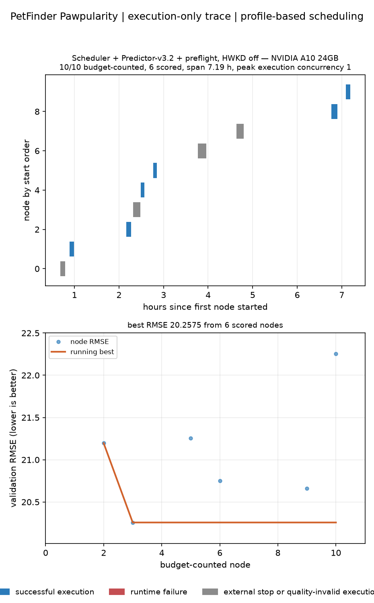

# PetFinder: Scheduler + Predictor v3.2 + Pre-flight Checker on A10

## Scope and completion evidence

This is the completed ten-node PetFinder Pawpularity search launched at
`2026-09-12 02:15:36 UTC`.  It used one NVIDIA A10 24 GB GPU and had the
following required configuration:

| Setting | Value |
| --- | --- |
| Scheduler | enabled; `parallel_time_aware`, `backend_aware`, `cuda_process` |
| Predictor | Predictor v3.2, CUDA capture, local code and weight artifact |
| Pre-flight checker | enabled, A10 24 GB target, at most four repair rounds |
| Hardware Knowledge Database (HWKD) | disabled (`hardware_knowledge.enabled=false`; `agent.hardware_context_enabled=false`) |
| Fixed max-parallel-jobs limit | none; `agent.search.parallel_search_num=null` |
| Node budget | 10 budget-counted nodes |
| Code model | local Qwen3.8-27B INT8 through vLLM on a separate A100 80 GB PCIe |

The controller log records `Scheduler-controlled progress: 10/10
budget-counted nodes` at `09:35:24 UTC`; its process then exited and the A10
video-memory allocation returned to zero.  This is a completed Scheduler run,
not a partial replay.

## Results

| Quantity | Observed value |
| --- | --- |
| Budget-counted nodes | 10/10 |
| Valid scored nodes | 6 |
| Best validation Root Mean Squared Error (RMSE) | **20.2575** (`a6ebd48c`) |
| Second-best validation RMSE | 20.6590 (`0fdde626`) |
| Execution span | 7.19 h |
| Peak execution concurrency | 1 (one A10) |

The valid validation RMSE values were 21.1961, 20.2575, 21.2559, 20.7500,
20.6590, and 22.2540.  Four budget-counted executions were not scored: two
were externally terminated (`SIGTERM` / time-limit output) and two produced
quality-invalid or unusable final output.  They are shown in gray, not red, in
the chart.  No budget-counted node had an attributable candidate runtime
exception; short rejected candidates outside the budget are retained in the
raw trace and are not plotted as runtime bugs.

## Runtime-estimation evidence

The Scheduler received non-null epoch-probe estimates during execution.  For
example, node `0fdde626` reached confidence 0.95 with an estimated total of
483.84 s and completed in 493.46 s.  The final node `8a7deeb5` similarly had
live estimates after its first epoch.  Thus the Scheduler was supplied a
measured runtime estimate rather than the former permanent `None` value.  The
final node early-stopped, so its initial total-time estimate was conservative;
this is a calibration limitation, not missing estimation data.

## Local Qwen vLLM service evidence

The A100 service remained live for the whole search as
`qwen3.8-27b-int8-a100`, using the local `Qwen3.8-27B-INT8-W8A16-MTP` weights,
Tensor Parallelism 1, maximum context 131072, prefix caching, Triton
attention, and eager execution.  During active controller requests, vLLM
reported sustained generation throughput of **about 33--34 tokens/s** for one
request; it served a two-request interval at about 40 tokens/s total.  These
are service logs, not a separately normalized benchmark.

The running controller retained its historical 16384 completion-token setting.
It was not restarted in order to preserve this experiment.  The local default
for future launches has been changed to uncapped completion generation.

## Pre-flight observations

Pre-flight prevented non-executing candidate failures from consuming the A10
node budget.  The final candidate initially failed its batch-size-one check
because a tabular BatchNorm layer received `[1, 128]`; the pre-flight repair
loop fixed it and the admitted node executed successfully.  Other rejected
candidates included parameter-membership tensor comparison and scalar
regression-head shape faults.  Targeted local repair guidance and tests were
added for those two recurring diagnoses.

The controller also attempted an optional `127.0.0.1:5005` review service after
two successful executions.  That endpoint was absent, but the code-format,
content-quality, metric-direction, and final-output validation all passed; it
did not change those nodes' metrics.  This noisy optional dependency should be
removed or made explicit in a future launcher.

## Durable artifacts and verification

- `2026-09-12_petfinder_scheduler_v32_a10_raw/` contains the copied input
  cache, Scheduler database/logs, pipeline state, and extracted experiment
  tree.  File counts and byte totals for input, Scheduler, and pipeline match
  the remote source.
- `2026-09-12_petfinder_scheduler_v32_a10_experiment_complete.tgz` is the
  independently transferred complete experiment archive.  It contains 447
  entries, exactly matching the remote experiment tree; SHA-256 is
  `abfaf9d7441900354f4d6ae3d1dd7d3d515f3d538ea7726d45bc117a530d5b5e`.
- `2026-09-12_petfinder_scheduler_v32_a10_combined.png` is the required
  single image with Gantt above and validation-RMSE-by-node below.

No baseline comparison is claimed here: this record contains only the completed
Scheduler + Predictor v3.2 + pre-flight, HWKD-off A10 run.
