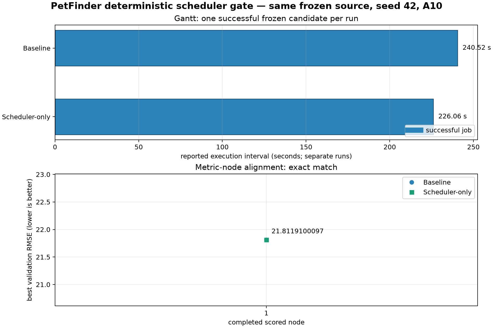

# PetFinder deterministic baseline vs Scheduler gate

## Purpose

This is a one-node reproducibility gate, not a throughput experiment.  It
checks that enabling the Scheduler does not change the candidate, dataset,
randomness contract, or metric before a multi-node comparison is allowed.

## Controlled settings

| Item | Value |
| --- | --- |
| Task / data | PetFinder public task snapshot on Nautilus A10 |
| LLM | Local `qwen3.8-27b-int8-a100` service |
| Code, NumPy, PyTorch, and LLM seed | 42 |
| Candidate source SHA-256 | `4a33d415be032f5c95b215ce78a7ed0ff2cc2cefa72a2aeb44e9ffe674f86a13` |
| Baseline | Scheduler disabled; Hardware Knowledge Database and preflight disabled |
| Treatment | Scheduler enabled; Predictor v3.2 required; Hardware Knowledge Database and preflight disabled |
| GPU backend | One A10, CUDA process backend |
| Fixed parallel cap | None configured |

The source was generated once by the seeded baseline, copied unchanged into
the Scheduler run, and verified by SHA-256 before replay.

## Result

| Run | Status | Best validation RMSE | Reported execution interval |
| --- | --- | ---: | ---: |
| Baseline | successful | 21.8119100097 | 240.52 s |
| Scheduler-only | successful | 21.8119100097 | 226.06 s |

The best metric matches exactly.  This proves the Scheduler path preserved the
frozen candidate's measured result in this gate.

The two reported durations are from separate process implementations and a
single repetition, so they are **not** evidence of a scheduler speedup.  No
multi-node throughput or makespan claim is made here.

## Scheduler evidence and repaired faults

- Admission used `vram_prediction_source = ml_predictor` with no prediction
  error; the scheduler did not fall back to a missing profile.
- The first epoch installed an `epoch_1` runtime estimate rather than leaving
  estimation time `None`; the completed job replaced it with a 232.92-second
  wall-clock profile.
- The original cold Predictor estimate was not accurate enough for planning
  this candidate, so subsequent multi-node work must use the live profile and
  evaluate estimate error separately.
- Python, NumPy, PyTorch CPU/CUDA, cuDNN deterministic mode, deterministic
  PyTorch algorithms, `PYTHONHASHSEED`, and `CUBLAS_WORKSPACE_CONFIG` are now
  set before candidate imports in both execution paths.
- Raw-script jobs without an explicit checkpoint preload source no longer try
  to preload executable Python as a model artifact.

## Trace locations

- Baseline: `records/2026-09-16_petfinder_deterministic_baseline_vs_scheduler_gate_raw/baseline/`
- Scheduler: `records/2026-09-16_petfinder_deterministic_baseline_vs_scheduler_gate_raw/scheduler/`
- Chart generator: `scheduler_benchmark_test/draw_petfinder_deterministic_gate.py`

The Scheduler trace includes its SQLite state, events, decision state, source
copy, instrumented source, and result JSON.  The baseline trace includes the
journal, configuration, prompt record, source, result, and hardware samples.

## Next gate

Build a frozen sequence of at least ten seeded baseline candidates, then replay
exactly that sequence under dynamic Scheduler admission.  Only after equal
candidate coverage is obtained may makespan, queueing, or parallelism be
compared.
