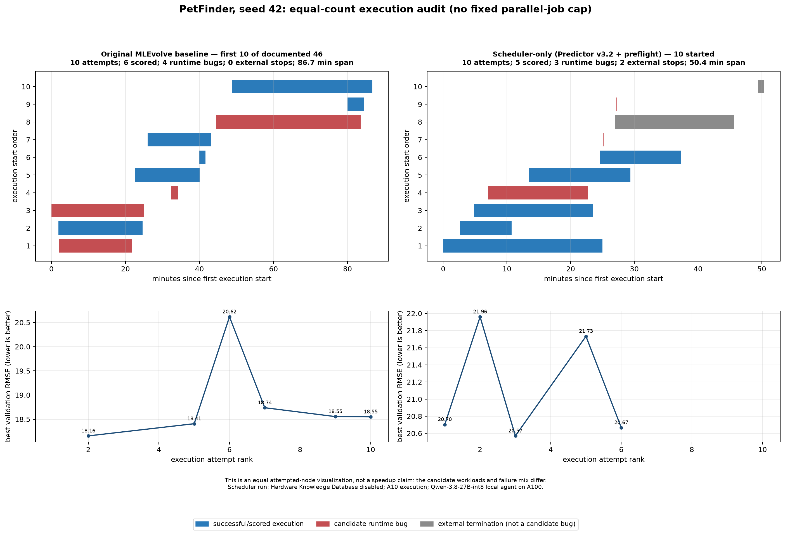

# PetFinder Scheduler-only A10 audit — 16 September 2026

## Scope and immutable settings

| Item | Value |
| --- | --- |
| Task / data | PetFinder public task, same task identifier and data directory used by the A10 experiment launcher |
| Search seed | `42` for agent, PyTorch, and NumPy paths |
| Agent | local Qwen-3.8-27B-int8 served from the A100 through the OpenAI-compatible endpoint |
| Candidate execution | one NVIDIA A10, CUDA-process backend |
| Scheduler | enabled; Predictor v3.2 required; preflight enabled |
| Hardware Knowledge Database | disabled (`hardware_knowledge.enabled=false`, `agent.hardware_context_enabled=false`) |
| Concurrency | dynamic admission only; `parallel_job_cap=null`; no fixed Max Parallel Jobs setting |
| Run window | 08:15–09:16 UTC, 16 September 2026 |

The run was deliberately stopped at the one-hour boundary after the tenth
candidate had started.  It was not restarted.  The Scheduler reached four
concurrent CUDA-process workers and the A10 reached full utilization without
an out-of-memory event.

## Audited outcome

There are eleven Scheduler database rows: ten started and terminalized, plus
one `READY` row that never started.  Only the ten started rows count as this
experiment's executed-node result.

| Outcome | Count | Treatment in the figure |
| --- | ---: | --- |
| Completed with a validation score | 5 | blue |
| Candidate runtime bug | 3 | red |
| External termination at the run boundary | 2 | gray, explicitly not a buggy node |
| Never started (`READY`) | 1 | excluded |

The five completed validation RMSE values were 20.7032, 21.9606, 20.5704,
21.7335, and 20.6669.  The best observed completed value was **20.5704**.

The two external stops were Scheduler job IDs `2b566f…` and `c70cfc…`.
Both terminal events have return code `-15`; they are not candidate failures.
The former had a cooperative cancellation request when its runtime probe rose
to 1,854.8 seconds, which would have exceeded the one-hour window.  The latter
was stopped by the launcher shutdown at the experiment boundary.

The three candidate runtime bugs were distinct generated-program failures:

- `0533c2…`: checkpoint deserialization after training, caused by PyTorch's
  `torch.load` default `weights_only=True` rejecting serialized NumPy state.
- `c2653d…`: `torch.flip(..., dims=[3])` applied to a `[C,H,W]` image tensor.
- `8082b9…`: `grid_sampler` input/grid batch-dimension mismatch.

The first is a runner compatibility issue.  The local runner now applies
`weights_only=False` only to direct local checkpoint loads; it does not relax
unrelated loads.  The other two are candidate-code bugs and are intentionally
left classified as such.

## Equal-count visual comparison

The figure compares the ten Scheduler attempts above with the first ten
historical budgeted executions from the documented **46-node original
MLEvolve** baseline.  For the historical trace, the original 60-second
accounting convention is reproduced: successful executions count, and buggy
executions count only after at least 60 seconds of work.  This yields six
scored and four runtime-bug attempts in the selected baseline prefix.

The chart is **not evidence of a speedup or a quality improvement**.  The
equal count makes the schedule visually comparable, but the candidate programs
and failure mix differ.  In particular, the baseline prefix's best RMSE is
18.1561, whereas this Scheduler prefix's best is 20.5704.  A valid speed or
quality claim requires replaying the same generated candidate sequence (or a
controlled matched set), not dividing wall times from these different
workloads.

## Reproducibility artifacts

- Raw Scheduler database, event log, generated files, result JSON files, and
  pipeline trace: `records/2026-09-16_petfinder_scheduler_v32_a10_one_hour_10executed_raw/mlevolve_petfinder_scheduler_v32_a10_20260916_081524/`
- Figure renderer: `scheduler_benchmark_test/draw_petfinder_one_hour_10executed.py`
- Combined figure: `records/2026-09-16_petfinder_original46_vs_scheduler10_a10_combined.png`
- Launcher settings: `deployments/run_petfinder_scheduler_v32_a10.sh`

The renderer was executed against the preserved SQLite/event trace and checks
that exactly ten terminal Scheduler attempts are present before it writes the
figure.  The local raw-trace manifest was compared with the durable remote
copy after collection: all 236 files match (including the launcher log).
