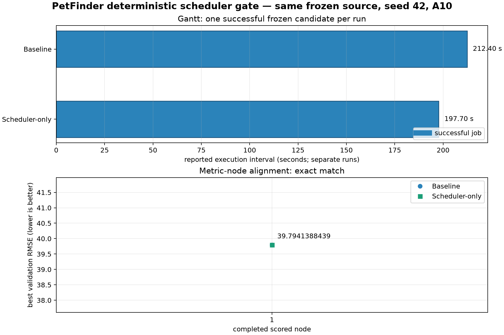

# PetFinder strict seed-42 baseline vs Scheduler-only gate

## Scope

This is the authoritative one-node reproducibility gate.  It is deliberately
not a multi-node throughput result.

The local Qwen draft prompt was byte-identical to the prior seeded baseline
prompt (SHA-256 `6f6f8f3b63d4e691a738079276233bc6822817552c06a681677c9389a1b0fa4a`).
With seed 42, it regenerated the exact candidate source used by the earlier
baseline gate:

`77fbaacf6310dc6b3e442f3dd0ad483da2a2dda05071ff1adaa5e217ad56749a`

## Controlled settings

| Item | Value |
| --- | --- |
| Task / data | PetFinder public snapshot on Nautilus A10 |
| Agent | Local `qwen3.8-27b-int8-a100` |
| Prompt time budget | 10,800 seconds in both baseline prompts |
| Randomness | LLM, Python, NumPy, PyTorch CPU/CUDA seed 42 |
| CUDA determinism | cuDNN deterministic mode, deterministic PyTorch algorithms, `CUBLAS_WORKSPACE_CONFIG=:4096:8` |
| Baseline | Scheduler off; Hardware Knowledge Database and preflight off |
| Scheduler-only | Predictor v3.2 required; Hardware Knowledge Database and preflight off |
| Execution backend | CUDA process on one A10 |
| Fixed parallel cap | None configured |

## Result

| Run | Candidate SHA-256 | Best validation RMSE | Reported execution interval |
| --- | --- | ---: | ---: |
| Baseline | `77fbaacf…ad56749a` | 39.7941388439 | 212.40 s |
| Scheduler-only | `77fbaacf…ad56749a` | 39.7941388439 | 197.70 s |

The metric is exactly equal.  Thus the Scheduler-only path preserves the
candidate's measured result under the same prompt, source, seed, data, and
GPU.

The execution intervals come from separate process implementations and only
one repetition.  They must **not** be reported as a speedup, makespan gain, or
multi-node improvement.

## Scheduler evidence

- Admission recorded `vram_prediction_source = ml_predictor` and no Predictor
  error, so this experiment did not fall back to a missing branch profile.
- `RuntimeProbeSpec(strategy="epoch_1")` installed live epoch timing rather
  than leaving estimation time `None`; on completion, the Scheduler persisted
  a 203.65-second runtime profile.
- Raw scripts without an explicit checkpoint no longer run a meaningless model
  cache preload.

## Trace locations

- Baseline: `records/2026-09-17_petfinder_seed42_strict_baseline_vs_scheduler_raw/baseline/`
- Scheduler: `records/2026-09-17_petfinder_seed42_strict_baseline_vs_scheduler_raw/scheduler/`
- Figure source: `scheduler_benchmark_test/draw_petfinder_deterministic_gate.py`

Both traces retain source, prompt record, logs, result JSON, SQLite scheduler
state, scheduling decisions, and hardware samples.  Dataset links are kept as
links; the dataset itself was not copied into the repository.

## Required next experiment

Generate and freeze at least ten baseline candidates under the same complete
prompt contract, then replay precisely that sequence under dynamic Scheduler
admission.  Only equal candidate coverage can support a throughput or
makespan comparison.
